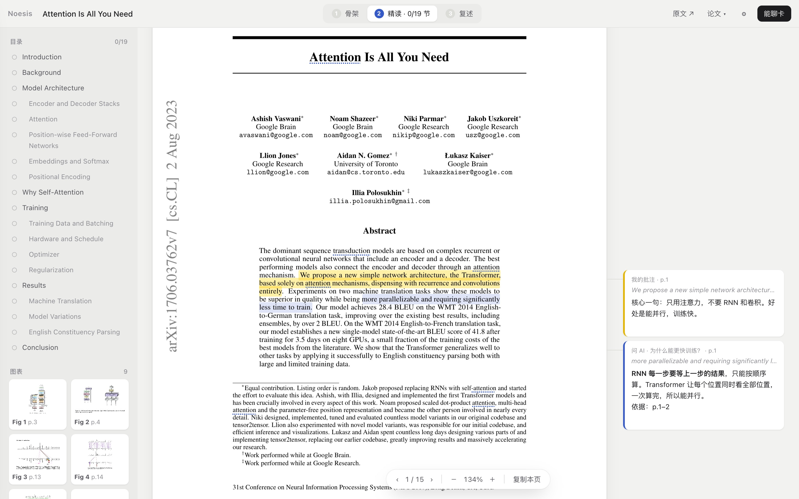
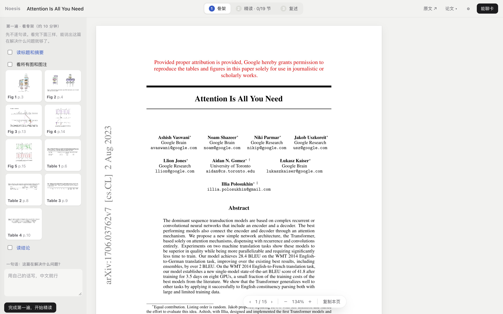
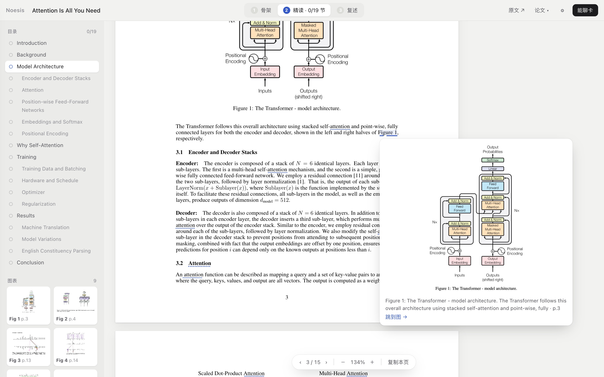
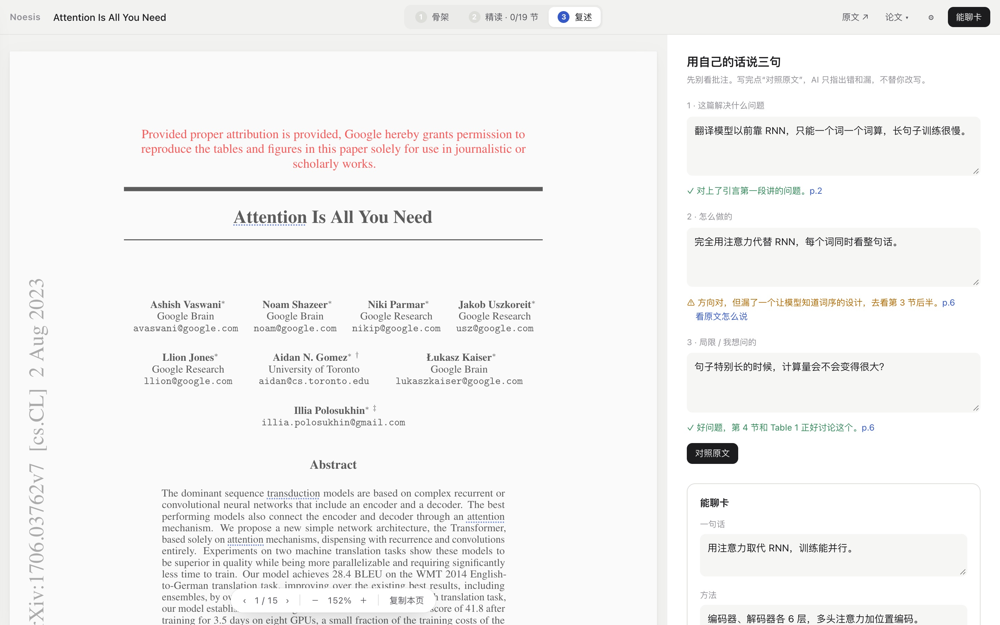
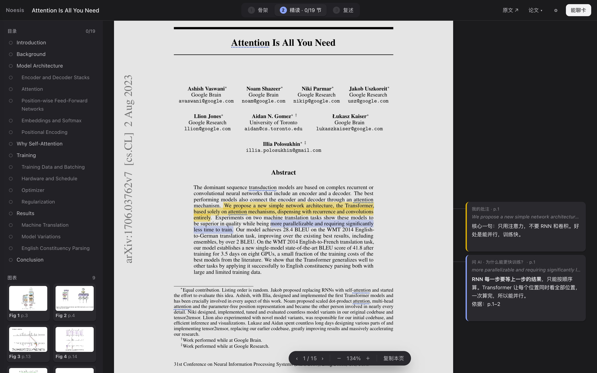

<div align="center">

# Noesis Paper Reader

**Read a research paper in three passes — and come out able to explain it.**

三遍读懂一篇论文：先看骨架，再精读，最后用自己的话复述。

[**Open the app →**](https://rexxall.github.io/noesis-paper-companion/) · [Features](#features) · [Quick start](#quick-start) · [AI setup](#ai-setup) · [Privacy](#privacy) · [中文说明](#中文说明)



</div>

## Why

A PDF viewer plus a chat window is a slow way to learn a paper. You copy passages back and forth, your notes end up somewhere else, and an AI that summarises for you leaves you with nothing you can say yourself.

Noesis keeps everything on the paper. It walks you through three passes: get the skeleton, read closely, then say what the paper did in your own words. The AI helps along the way, but it never writes the summary for you. When you check your summary, it points to what is missing and where to look, and shows the answer only if you ask.

## Features

### 1 · Skeleton (about 10 minutes)



- One click to the abstract, each figure and table (with thumbnails), and the conclusion.
- Write one sentence: *what problem does this paper solve?* You need it to move on.

### 2 · Close reading

- **Select any text** → translate, add a note, ask the AI, save it as a term, or highlight it.
- **Margin notes.** Notes and AI answers sit beside the paragraph they belong to, joined by a thin line. Hover over a card and its passage lights up.
- **Terms follow you.** Save a term once, and every place it appears in the paper gets a dotted underline. Hover over one to see your own explanation and how often the term appears.
- **Click “Figure 3”** in the text and the figure pops up, trimmed to the figure itself, with a jump link.


- **Outline with progress.** Sections come from the PDF's bookmarks or are detected from the layout. Tick them off as you go.
- **Translation without an AI key.** A built-in machine translation, plus phonetics and word senses for single words.

### 3 · Recap



- Write three sentences: the problem, the method, a limitation or question.
- **Check against the paper.** The AI marks each sentence ✓ / ⚠ / ✗ and gives a *hint* (what is missing, which section to read) plus a page link. Click **看原文怎么说** to see what the paper actually says.
- **Talk card.** One line, method, limitation, and a question you could ask the authors. Bring it over from your recap or let the AI draft it from your own words, then export it as Markdown, as a `.md` file, or straight into **Obsidian**.

### Also

- Add papers by arXiv ID, PDF link, or upload. Each paper keeps its own notes, terms and recap.
- Dark mode follows your system.
- Installable as an app on a phone or desktop (PWA).



## Quick start

1. Open **https://rexxall.github.io/noesis-paper-companion/**.
2. Click **论文 ▾** and paste an arXiv ID (for example `1706.03762`) or a PDF link, or upload a PDF.
3. Follow the three steps at the top: **骨架 → 精读 → 复述**.

On a phone: iPhone → Safari → Share → *Add to Home Screen*; Android → Chrome → menu → *Install app*.

## AI setup

The AI is optional. Without a key, every AI button copies a ready-made prompt you can paste into any chat tool.

To get answers directly, open **⚙︎** and pick a service:

| Service | What to enter | Default model |
|---|---|---|
| DeepSeek | API key | `deepseek-chat` |
| OpenAI | API key | `gpt-5.2-mini` |
| Other (OpenAI-compatible) | Base URL + API key | your choice |

The page sends requests straight from your browser to the service you choose.

Cost note: **对照原文** and **问整篇论文** send up to about 60,000 characters of the paper (roughly 15k tokens).

## Privacy

| What | Where it lives |
|---|---|
| Your papers list, notes, terms, recap | This browser only (localStorage) |
| Uploaded PDFs | This browser only (IndexedDB) |
| API key | This browser only; sent only to the AI service you picked |
| Selected text you translate without a key | Sent to Google Translate (MyMemory as a fallback) |

There is no account and no server of our own. Notes do not sync between devices, so export your talk card to keep it.

## How it works

A single static `index.html`. No build step, no framework.

- **PDF rendering:** [PDF.js](https://mozilla.github.io/pdf.js/) 4.10. Pages render lazily while you scroll and are drawn at the screen's pixel density, so text stays sharp on Retina displays.
- **Selectable text:** an invisible text layer placed at each glyph's top edge and stretched to the PDF's real text width. Lines are split where a saved term or a figure reference sits, so each one can be styled and clicked.
- **Structure:** text lines are grouped by position. The body font size is the most common size. Headings come from numbering, known section names and font size, unless the PDF has bookmarks. Captions are lines that start with *Figure n* or *Table n*.
- **Figure previews:** the area between the last full line of body text and the caption, cropped to where the ink is.
- **AI:** OpenAI's Responses API, or chat completions for DeepSeek and other compatible services. The recap check asks for JSON (verdict, hint, answer, page) and shows the answer only on request.

Run it locally:

```bash
python3 -m http.server 8000
```

Then open http://localhost:8000.

## Known limits

- Heading and caption detection is heuristic. Unusual layouts may miss a section or crop a figure loosely.
- Some sites block loading their PDFs from another page. Download the file and upload it instead.
- Saving to Obsidian uses an `obsidian://` link, so very long notes may be cut off. Use **下载 .md** for those.

## Changelog

**v3.0.0 — Three-pass reader**

- Rebuilt around three passes: skeleton, close reading, recap.
- Added margin notes, terms underlined across the paper, clickable figure references with previews, and an outline with progress.
- Added the recap check (hint first, answer on request) and a talk card exported to Markdown or Obsidian.
- Added DeepSeek and other OpenAI-compatible services, translation without an AI key, sharp rendering on Retina, dark mode and figure thumbnails.
- Notes and term cards from v2 are carried over automatically.

**v2 — General reader.** Any paper by arXiv ID, link or upload; separate notes per paper.

**v1 — First version.** A reading companion for a single paper.

---

## 中文说明

**这是什么：** 一个读论文的网页应用。它不替你总结，而是带你读三遍：
1. **骨架：** 一键跳到摘要、每张图、结论，写下一句“这篇在解决什么问题”。
2. **精读：** 划词即可翻译、批注、问 AI、记成术语。批注贴在原文旁边；记过的术语在全文自动画虚线；点正文里的“Figure 3”直接弹出那张图。
3. **复述：** 用自己的话写三句。AI 对照原文只给提示和页码，答案要你点“看原文怎么说”才显示。最后生成一张“能聊卡”，存进 Obsidian。

**怎么开始：** 打开 https://rexxall.github.io/noesis-paper-companion/ ，点“论文 ▾”，输入 arXiv 编号或 PDF 链接，也可以上传 PDF。

**AI：** 可以不填 key，这时会复制现成的提示词，贴到任意 AI 聊天工具。要直接回答，在 ⚙︎ 里选 DeepSeek、OpenAI 或其他兼容接口，填上 key 即可。key 只存在你的浏览器里。

**隐私：** 论文列表、批注、术语、复述都只存在这台设备的浏览器里，没有账号，也没有服务器。没填 key 时，划词翻译的文字会发给 Google 翻译。
