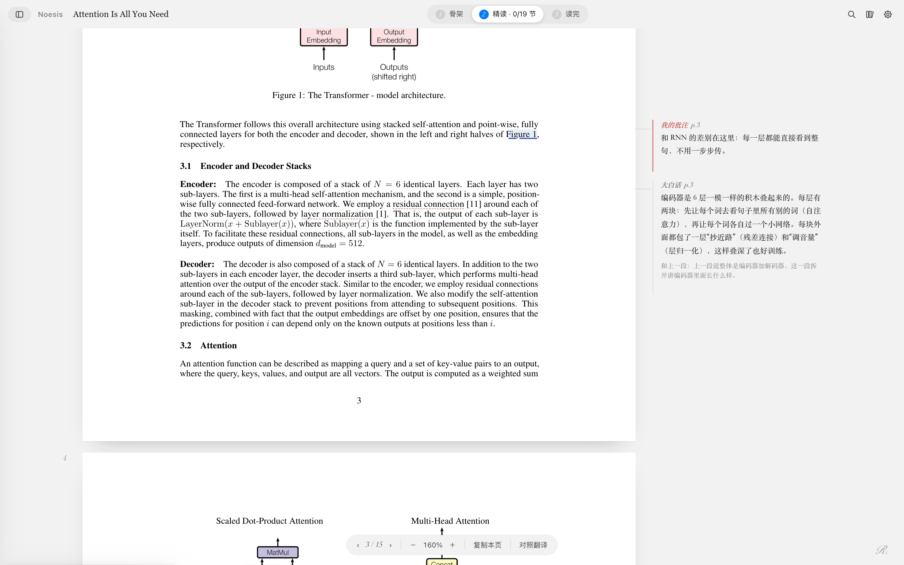
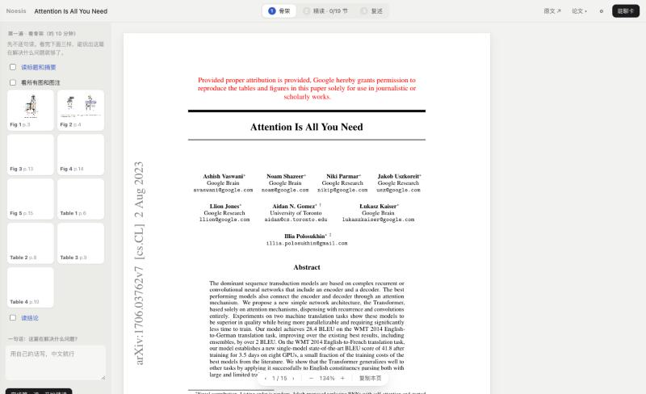
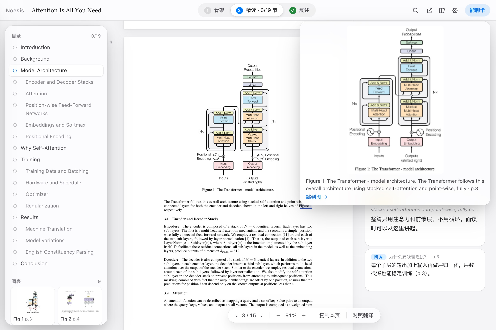
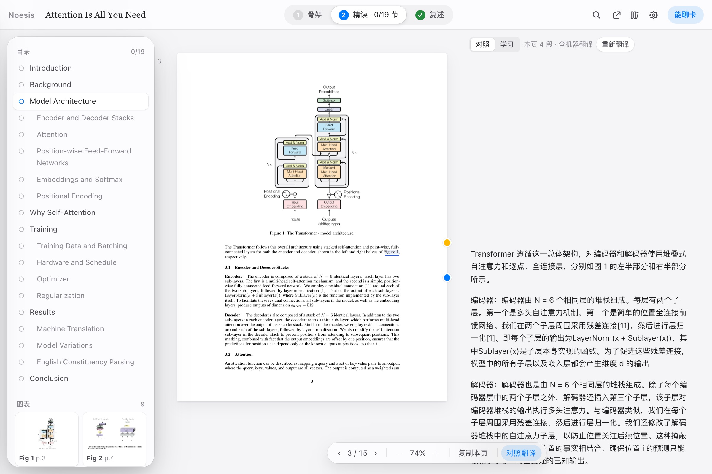
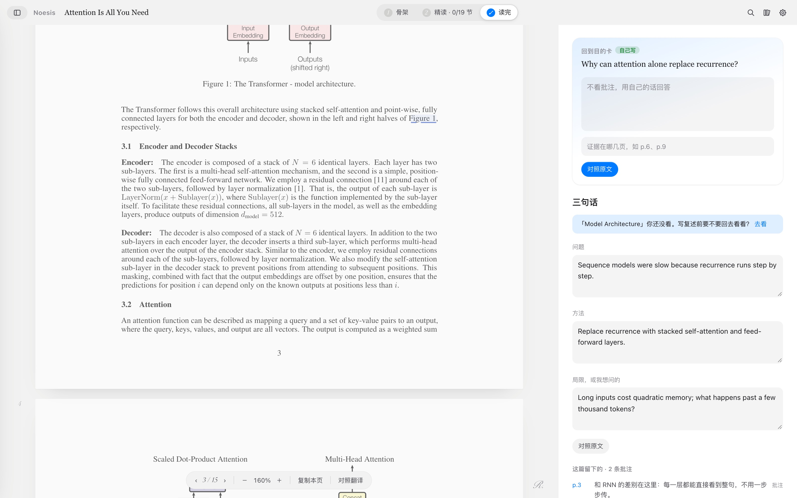
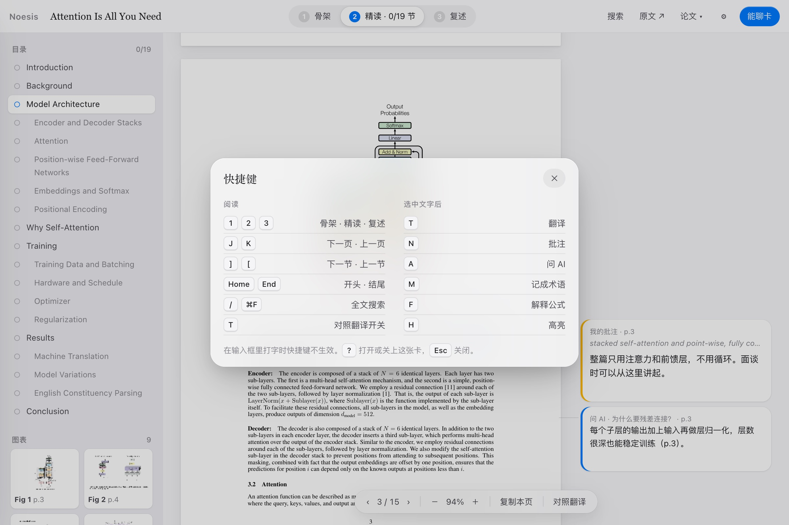

<div align="center">

# Noesis Paper Reader

**Read a research paper in three passes — and come out able to explain it.**

三遍读懂一篇论文：先看骨架，再精读，最后用自己的话讲出来。

*AI never writes your summary. It only shows up after you have.*

[**Open the app →**](https://rexxall.github.io/noesis-paper-companion/) · [Features](#features) · [Quick start](#quick-start) · [AI setup](#ai-setup) · [Privacy](#privacy) · [中文说明](#中文说明)

<picture>
  <source media="(prefers-color-scheme: dark)" srcset="docs/screenshots/reading-dark.jpg">
  
</picture>

</div>

## Why

A PDF viewer plus a chat window is a slow way to learn a paper. You copy passages back and forth, your notes end up somewhere else, and an AI that summarises for you leaves you with nothing you can say yourself.

Noesis keeps everything on the paper. It walks you through three passes: get the skeleton, read closely, then say what the paper did in your own words. The AI helps along the way, but it never writes the summary for you. When you check your summary, it points to what is missing and where to look, and shows the answer only if you ask.

## Features

### Open and read

- **One field.** Paste an arXiv ID or a PDF link, or drop a PDF anywhere on the page; the paper opens on page 1 with the outline tucked away.
- **One question first.** A line above page 1 asks what you want to find out this time. It comes back when you finish.
- **Concepts the paper assumes you know.** With an AI key, Noesis lists them as soon as the paper opens and underlines each one where it first appears. Click one for a short explanation and the page the AI says defines it, then mark it *known*, *unsure* or *new*.
- **Press `W` on a paragraph** for a plain-language rewrite in the margin, with one line on how it follows from the paragraph before.
- **A margin notebook.** Notes sit beside their paragraph as handwritten-style text; your own notes carry a red rule, AI answers do not. One card per paragraph; the rest fold into "N more". Switch back to cards in ⚙︎.

### 1 · Skeleton (about 10 minutes)



- One click to the abstract, each figure and table (with thumbnails), and the conclusion.
- Write one sentence: *what problem does this paper solve?* You need it to move on.

### 2 · Close reading

- **Select any text** → translate, add a note, ask the AI, save it as a term, or highlight it.
- **Margin notes.** Notes and AI answers sit beside the paragraph they belong to, joined by a thin line. Hover over a card and its passage lights up.
- **Terms follow you.** Save a term once, and every place it appears in the paper gets a dotted underline. Hover over one to see your own explanation and how often the term appears.
- **Click “Figure 3”** in the text and the figure pops up, trimmed to the figure itself, with a jump link.


- **Outline with progress.** Sections come from the PDF's bookmarks or are detected from the layout. Tick them off as you go.
- **Translation without an AI key.** A built-in machine translation, plus phonetics and word senses for single words.



### 3 · Done — say it out loud

<picture>
  <source media="(prefers-color-scheme: dark)" srcset="docs/screenshots/recap-dark.jpg">
  
</picture>

- Press `R` (or reach the end of the paper). Answer the question you started with, then write three sentences: the problem, the method, a limitation or question. If you skimmed a section, Noesis says so before you start.
- **What this paper left you:** every note and rewrite in page order, and one **存成笔记** button that writes this paper as Markdown into a folder you pick (an Obsidian vault works). Saving again replaces only Noesis's own block, so anything you wrote around it stays. Where folders can't be written (Safari, phones) you get a zip.
- Spoken retelling, interview practice and the talk card are under **更多**.
- **Say it.** Press the mic and retell the paper in 60 seconds; the AI checks what you covered and what you missed. A week later it asks you to retell it again, and shows the two side by side.
- **Interview practice.** The AI plays the paper's author and asks you five questions, one at a time, with a hint and a model answer you could say in an interview.
- **Check against the paper.** The AI marks each sentence ✓ / ⚠ / ✗ and gives a *hint* (what is missing, which section to read) plus a page link. Click **看原文怎么说** to see what the paper actually says.
- **Talk card.** One line, method, limitation, and a question you could ask the authors. Bring it over from your recap or let the AI draft it from your own words, then export it as Markdown, an image, a `.md` file, or straight into **Obsidian**.
- **Phrases worth keeping.** Academic expressions picked from the paper, each with when to use it.

### Reading a professor's work

- **Professor packs.** Type a name; pick their recent papers from OpenAlex; read them in order. Then generate a *research line*: themes, methods, recent shifts, and the questions you could ask.
- **First-contact letter.** Drafted from *your own notes* on their papers, never from thin air; in Japanese it follows business-email form and comes with a Chinese gloss.
- **One-page brief.** Everything above on one printable page for the interview.
- **Follow the citations.** Click a reference in the text to see the paper; build a pack from the most-cited ones in one click.

### Also

- Add papers by arXiv ID, PDF link, upload, or a Zotero `.bib` / `.ris` export. Each paper keeps its own notes, terms and recap.
- **Picks up where you left off.** Each paper reopens at the page and spot you last read.
- **Keyboard first.** Press `?` for the cheat sheet (below): `1` `2` `3` switch passes, `J` / `K` pages, `]` / `[` sections, `/` search, and after selecting text `T` translate, `N` note, `A` ask, `M` term, `H` highlight.
- **Reading time.** Minutes spent on each pass are counted only while you are actually reading (the tab is visible and you did something in the last 90 seconds). They show in the paper list, on the finish card, and as `reading_minutes` in the exported note.
- **Glass controls.** Bars and popovers are translucent glass over the page. With *Reduce transparency* or *Increase contrast* on, the glass turns solid; with *Reduce motion*, nothing animates. Light and dark follow your system.
- Open a paper straight from a link: `?open=<arXiv ID or PDF link>&title=…`.
- Full-text search across the paper, your notes and terms (⌘F). Paragraph-by-paragraph translation aligned beside the original, or a *learning mode* that only glosses hard sentences and new words.
- Box-select a figure or formula on blank space and ask about it; vision-capable models get the image.
- Dark mode follows your system.
- Installable as an app on a phone or desktop (PWA). After the first visit the reader works offline for uploaded papers.

<picture>
  <source media="(prefers-color-scheme: dark)" srcset="docs/screenshots/keys-dark.jpg">
  
</picture>

## Quick start

1. Open **https://rexxall.github.io/noesis-paper-companion/**.
2. Paste an arXiv ID (for example `1706.03762`) or a PDF link into the field, or drop a PDF on the page.
3. Read. Press `R` when you're done; the three steps at the top are **骨架 → 精读 → 读完**.

On a phone: iPhone → Safari → Share → *Add to Home Screen*; Android → Chrome → menu → *Install app*.

## AI setup

The AI is optional. Without a key, every AI button copies a ready-made prompt you can paste into any chat tool.

To get answers directly, open **⚙︎** and pick a service:

| Service | What to enter | Default model |
|---|---|---|
| Claude | API key | `claude-sonnet-5-5` |
| DeepSeek | API key | `deepseek-chat` |
| OpenAI | API key | `gpt-5.2-mini` |
| Other (OpenAI-compatible) | Base URL + API key | your choice |

The page sends requests straight from your browser to the service you choose.

Cost note: **对照原文** and **问整篇论文** send up to about 60,000 characters of the paper (roughly 15k tokens).

## Privacy

| What | Where it lives |
|---|---|
| Your papers list, notes, terms, recap, reading position and time | This browser only (localStorage) |
| Uploaded PDFs | This browser only (IndexedDB) |
| API key | This browser only; sent only to the AI service you picked |
| Selected text you translate without a key | Sent to Google Translate (MyMemory as a fallback) |

There is no account and no server of our own. Notes do not sync between devices, so export your talk card to keep it.

## How it works

A single static `index.html`. No build step, no framework.

- **PDF rendering:** [PDF.js](https://mozilla.github.io/pdf.js/) 4.10. Pages render lazily while you scroll and are drawn at the screen's pixel density, so text stays sharp on Retina displays.
- **Selectable text:** an invisible text layer placed at each glyph's top edge and stretched to the PDF's real text width. Lines are split where a saved term or a figure reference sits, so each one can be styled and clicked.
- **Structure:** text lines are grouped by position. The body font size is the most common size. Headings come from numbering, known section names and font size, unless the PDF has bookmarks. Captions are lines that start with *Figure n* or *Table n*.
- **Figure previews:** the area between the last full line of body text and the caption, cropped to where the ink is.
- **AI:** OpenAI's Responses API, or chat completions for DeepSeek and other compatible services. The recap check asks for JSON (verdict, hint, answer, page) and shows the answer only on request.

Run it locally:

```bash
python3 -m http.server 8000
```

Then open http://localhost:8000.

## Known limits

- Heading and caption detection is heuristic. Unusual layouts may miss a section or crop a figure loosely.
- Some sites block loading their PDFs from another page. Download the file and upload it instead.
- Saving to Obsidian uses an `obsidian://` link, so very long notes may be cut off. Use **下载 .md** for those.

## Changelog

**v4.0.0 — Open straight into reading**

- One start field: paste an ID or link, or drop a PDF; the outline rail is hidden until you want it.
- A question line above page 1, answered again when you finish.
- Concepts the paper assumes you know are listed automatically and underlined in place, with a short explanation and a page to check.
- `W` rewrites a paragraph in plain words, in the margin.
- Margin notebook look (switchable): one card per paragraph, your own notes marked with a red rule.
- Without a key, the copy-and-paste helper docks in a corner instead of covering the page.
- Done panel: your question, three sentences, what the paper left you, and one button to save it as Markdown into a folder. Re-saving keeps what you wrote around Noesis's block.
- Zoom, resizing and the outline rail keep your reading position; an AI answer that arrives after you switch papers stays with the paper it was about.
- Claude as an AI service, with prompt caching.

**v3.2.0 — Pick up where you left off**

- Reopening a paper goes back to the page and spot you last read.
- Keyboard shortcuts with a cheat sheet (`?`), including one-key actions on selected text.
- Reading time per pass, shown in the paper list and finish card and exported with the note.
- `?open=` links open a paper directly.
- Saving a custom AI service without a model name now warns you.
- New look in the current Apple glass style: translucent bars, popovers and panels; capsule buttons and segmented controls; rounded margin notes with a small tag; a floating glass outline; icon buttons in the top bar. The "mist" theme is removed.

**v3.1.0 — Say it out loud**

- Spoken retelling with a check against the paper; retell again a week later; a nudge for sections you skimmed.
- Interview practice, first-contact letter drafts, professor one-page brief, phrases worth keeping.
- Citation cards and citation-chain packs, full-text search, paragraph translation with a learning mode, box-select to ask, AI skim highlights, formula explanations, DeepSeek and OpenAI-compatible services, `.bib` / `.ris` import, backup, mist theme, offline reader.

**v3.0.0 — Three-pass reader**

- Rebuilt around three passes: skeleton, close reading, recap.
- Added margin notes, terms underlined across the paper, clickable figure references with previews, and an outline with progress.
- Added the recap check (hint first, answer on request) and a talk card exported to Markdown or Obsidian.
- Added DeepSeek and other OpenAI-compatible services, translation without an AI key, sharp rendering on Retina, dark mode and figure thumbnails.
- Notes and term cards from v2 are carried over automatically.

**v2 — General reader.** Any paper by arXiv ID, link or upload; separate notes per paper.

**v1 — First version.** A reading companion for a single paper.

---

## 中文说明

**这是什么：** 一个读论文的网页应用。它不替你总结，而是带你读三遍：
1. **骨架：** 一键跳到摘要、每张图、结论，写下一句“这篇在解决什么问题”。
2. **精读：** 划词即可翻译、批注、问 AI、记成术语。批注贴在原文旁边；记过的术语在全文自动画虚线；点正文里的“Figure 3”直接弹出那张图。
3. **读完：** 用自己的话写三句。AI 对照原文只给提示和页码，答案要你点“看原文怎么说”才显示。最后生成一张“能聊卡”，存进 Obsidian。

**4.0.0 新增：** 一个输入框就能打开论文（贴编号、链接或拖 PDF）；第 1 页上方写一句“这次想弄明白什么”；有 AI key 时自动列出论文默认你懂的概念并在原文画虚线；按 `W` 把一段改写成大白话放在页边；页边笔记本外观（可切换）；读完面板一键把这篇存成 Markdown 放进你选的文件夹（比如 Obsidian 库），再存只替换 Noesis 自己那一块。

**3.2.0 新增：** 再打开论文会回到上次读到的位置；按 `?` 看快捷键（`1` `2` `3` 切换三遍、`J` `K` 翻页、`]` `[` 跳节，选中文字后 `T` 翻译、`N` 批注、`A` 问 AI）；记录每一遍实际读了多少分钟（页面在前台、90 秒内有操作才计时），显示在论文列表和读完卡上，并写进导出笔记的 `reading_minutes`。

**怎么开始：** 打开 https://rexxall.github.io/noesis-paper-companion/ ，点“论文 ▾”，输入 arXiv 编号或 PDF 链接，也可以上传 PDF。

**AI：** 可以不填 key，这时会复制现成的提示词，贴到任意 AI 聊天工具。要直接回答，在 ⚙︎ 里选 DeepSeek、OpenAI 或其他兼容接口，填上 key 即可。key 只存在你的浏览器里。

**隐私：** 论文列表、批注、术语、复述都只存在这台设备的浏览器里，没有账号，也没有服务器。没填 key 时，划词翻译的文字会发给 Google 翻译。
